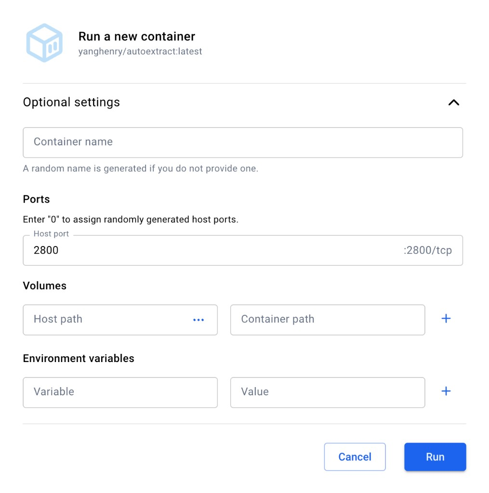

# AutoExtract

Extract numbers from charts in scientific papers (bar, dot, box, violin, and line plots). Drop in PDFs or images, review the results, and download Excel.

## Run with Docker (recommended)

Install [Docker Desktop](https://www.docker.com/products/docker-desktop/). Then either:

**Terminal**

```bash
docker pull yanghenry/autoextract:latest
docker run --rm -p 2800:2800 yanghenry/autoextract:latest
```

**Docker Desktop:** pull `yanghenry/autoextract:latest`, click Run, and set **Host port** to `2800` (container port is already `:2800/tcp`):



If the Host port is left empty and the app will not be reachable.

Open **http://127.0.0.1:2800**. Do not use `http://0.0.0.0:2800`.

## Using the app

Each page looks for one chart type. Drop the same papers on every page that applies.

- **Bar Analyzer** (`/bar_analyzer`): bar charts and dot plots (mean ± error bar)
- **Box Analyzer** (`/box_analyzer`): box plots (min, quartiles, median, max; estimated mean and SD)
- **Violin Analyzer** (`/violin_analyzer`): violin plots
- **Line Analyzer** (`/line_analyzer`): line plots (one row per point)

On each page: drop files, check flagged values, set SEM/SD and sample size **n** if needed, then **Download Excel** or copy rows.

Not handled: stacked bars, horizontal charts, scatter plots, micrographs.

## Run from source (optional)

Needs Python 3.10–3.12 and Node.js 20+.

```bash
git clone https://github.com/MohanYang03/AutoExtract.git
cd AutoExtract
python3 -m venv .venv
.venv/bin/python -m pip install -r requirements.txt
cd frontend && npm install && npm run build && cd ..
.venv/bin/python backend/app.py
```

On Windows, use `python` / `.venv\Scripts\python` instead of `python3` / `.venv/bin/python`.

Open **http://127.0.0.1:2800**. If the page 404s, the frontend is not built yet (`npm run build` in `frontend/`).

## Command line (optional)

```bash
python backend/batch_extract.py "path/to/papers" --out results.xlsx --review review_images/
python backend/batch_extract.py "path/to/papers" --type box --out box_plots.xlsx
```

`--type` can be `bar`, `box`, `violin`, or `line`.

## Acknowledgements

RapidOCR, PyMuPDF, Ultralytics YOLOv5, Flask, React, Vite.
